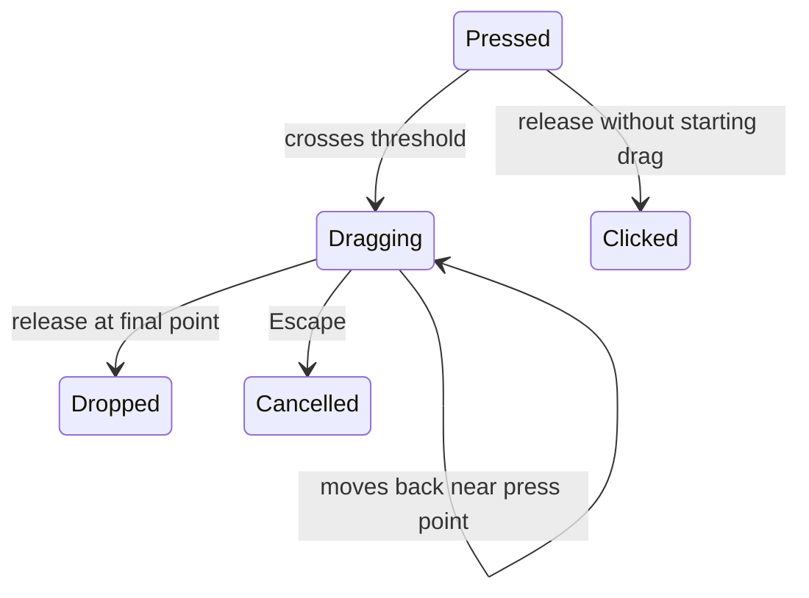

# Drag-and-drop feel audit — November 26, 2026

**Four confirmed application defects corrected;48 isolated replay scenarios pass.** This does not establish complete Windows95/98 drag fidelity or prove that a VM driver is responsible for the remaining feel difference. Product changes are confined to the five authorized `shell/app.py` hunks, preserving startup and other work. No live development VM, host pointer, keyboard/device configuration or user files were changed.

## Corrected behavior

1. **Dragging files stays active after crossing the threshold.** Previously, moving far away and then back near the press point left the ghost at its old distant position; releasing was treated as a click. Motion and release now use the latched drag state, consistently with desktop and shortcut drags.
2. **Desktop positions use the final release coordinate.** An already active drag no longer persists the stale last-motion position when release carries a newer point. The existing hotspot offset and desktop clamps are preserved.
3. **Start-folder shortcut positions use the final release coordinate.** The same stale-motion defect was corrected with the existing folder clamp.
4. **Ctrl-drag within the same folder makes a copy.** The reposition-only early return previously swallowed copy drops. Ctrl-copy now reaches existing FileClipboard naming/rollback behavior, producing `Copy of report.txt`, then `Copy (2) of report.txt`, preserving original bytes.

No drag-threshold adjustment, release-only drag activation, shortcut/link-effect redesign, hardware change or broad architecture change was made.

The preserved patch is `private/dnd-feel-20261126/authorized-app-delta.patch`; the pre-change source is retained privately. The first three defects produced12 failed assertions per viewport across96/120/144dpi. After those fixes, the same-folder Ctrl-copy case exposed another3 failures, one per DPI. These are **four defects**, not15 distinct bugs.

## Regression tool and evidence

`dev/check_dnd_feel.py` spawns its own Xvfb, checks the actual X11 display against its still-running same-user server PID, and uses disposable HOME/config/data/cache and fixture files. It calls the actual Shell press/motion/release handlers, redraws ghosts before release, saves screenshots, and journals raw synthetic coordinates, logical coordinates, modifiers and before/after drag state. It never connects to the user's physical display. Its default exit status is nonzero if any assertion fails.

Final current-harness evidence:

- `private/dnd-feel-20261126/wrapper-800-verified/`
- `private/dnd-feel-20261126/wrapper-1280-verified/`

Both exact screen sizes,800×600 and1280×800, pass24 scenarios each: eight scenario families at96/120/144dpi. Families cover latched file drag, desktop release endpoint, shortcut release endpoint, Escape cancellation, near-self folder reposition, real folder-margin transfer, endpoint clamping, and same-folder Ctrl-copy. The copy scenario additionally checks repeat naming, byte equality, original preservation, injected partial-copy cleanup, native error routing and selection retention. A new matching GI Cairo extension supplied by a parent test wrapper is propagated to owned-display children automatically.

Before-state evidence is preserved at `baseline-{800,1280}/`; `extended-800-before-copy-fix/` isolates the same-folder-copy failures. Re-running the initial traces after the first patch produced zero failures before extending the suite. All reports include source/script/manifest hashes, actual display/backend and uid1000. These are event-handler replays; their raw coordinates are generated fixture input, not recorded physical or QEMU input.

Existing relevant CPU tests pass: **7 Explorer operation tests +3 drop-geometry tests**. The existing `dev/check_folder_windows.py` also passes at800×600 and1280×800 under forced-X11/disposable HOME, covering independent paths/selection/scroll, real folder-to-folder and desktop transfers, Ctrl copy, cancellation, collision preservation, near-self handling, covered targets, nested-window path updates, position persistence and125% logical-DPI transfers. Evidence: `legacy-folder-{800,1280}/`. These are existing checks, not newly invented unit-test counts.

No new whole-screen native pixel match is claimed for DnD. Screenshots show before/after application state and ghost behavior; the legacy suite's named menu/icon comparisons do not prove native ghost labels, cursor overlays or every drag state.

## Native Windows95/98 facts

A private CRT-free i386 helper read real native APIs without changing settings. Raw files and hashes are under `private/dnd-feel-20261126/native-metrics/`; source/executable provenance is recorded there. Dedicated writable floppies were ejected, and verified checkpoints restored after every attempt. Win98 initially failed to launch the path because the US backslash scan code produced a different punctuation character in that guest. Opening A: and selecting the executable bypassed the input-layout mismatch; no keyboard/driver setting was changed.

| Native observation | Classic Windows95 | Community Windows98SE reference |
| --- | ---: | ---: |
| Reported OS version/build |4.0 /1111|4.10 /2222|
| Current framebuffer |800×600|800×600|
| DPI |96×96|96×96|
| SM_CXDRAG /SM_CYDRAG |2 /2|2 /2|
| Double-click time |500ms|500ms|
| Double-click rectangle |4×4|4×4|
| Icon/cursor nominal size |32×32|32×32|
| Reported mouse buttons |2|2|
| SPI_GETMOUSE thresholds/acceleration |[2,0,1]|[2,0,1]|

Both reference drivers enumerate1280×1024 modes but not1280×800. Therefore our1280×800 replay is an implementation viewport test; it is not a matching full-screen native reference test. Native controls/gestures must also be compared within common supported modes and native-relative regions.

Production `drag_started` currently uses4 logical pixels, while the queried native metric is2. **This discrepancy remains unresolved and was not tuned blindly.** A controlled native shell gesture trace must establish actual inclusive boundaries, pointer hotspot, diagonal behavior and any per-shell/profile differences. Previously named `native-drag-threshold-2/4/6.png` captures remain useful visual evidence, but their filenames alone are not an independently recorded pointer trajectory.

Read-only QMP input inventory is preserved in `input-backends.json`:

- All three Win95 references and the Win98 reference expose a current relative **QEMU PS/2 Mouse**.
- The development Linux VM exposes PS/2, vmmouse and a current absolute **QEMU Virtio Tablet**, not a USB tablet.

This proves a QMP routing difference, not a missing driver or measured physical response. Absolute tablet coordinates and relative motion with acceleration must not be compared as if they were the same stimulus. The Win98 community image is updated and is not an untouched stock Windows98 visual baseline; its provenance is documented separately.

## Remaining fidelity issues and test plan

| Area | Current evidence / next check |
| --- | --- |
| Drag threshold | Query results captured; actual native shell boundary sweep remains. Test each signed axis/diagonal at1–8px using recorded GetCursorPos, down/up state and screenshots. Do not infer the hotspot from the visible arrow's bounding box. |
| Folder hit margins | Existing measured short-label geometry and current real edge transfer pass. Revalidate native icon, label, interstitial margin, long/wrapped label and overlapping-cell boundaries with exact pointer positions. Keep background-drop acceptance distinct from folder acceptance. |
| Ghost and selection | Existing native hover image shows source selection retained and a dithered drag image with label. File ghost currently draws only an icon; desktop/virtual shortcut rendering moves its display position. Complete equivalent native ghost/selection state is not accepted. Capture press, first drag, valid target, invalid target, Escape and completion at identical cursor hotspot/anchor. |
| Cursor feedback | Copy/link/no-drop overlays are not accepted. Current handlers choose Ctrl copy on release but do not supply a complete shared effect/cursor model. Capture native modifier transitions during an active drag, including permitted versus forbidden targets. |
| Modifier operations | Same-folder file Ctrl-copy now works. Ctrl+Shift link semantics and virtual Start-folder shortcut copy semantics remain incomplete; avoid claiming full native modifier behavior. Test no keys, Ctrl, Shift and Ctrl+Shift at press, mid-drag and release. |
| Auto-scroll | Edge-hover auto-scroll is not established by current motion code. Test each client edge, scrollbar boundary, dwell delay, continued hold, scroll direction/rate, target recomputation and leaving the edge. Wheel-during-drag is a separate case. |
| Multi-selection | Test selected-item press without collapsing the group, drag from an unselected item, Ctrl toggling without drag, Shift ranges and multi-file failure/collision behavior. Existing focused cases do not cover every combination. |
| Cancellation/capture loss | Escape now passes for the changed path. Add right-button cancellation/menu, focus loss, button-up outside the guest/client, missing final motion, interrupted input and stale grabbed state. Release-only activation was deliberately not introduced without native evidence. |
| Windows and folders | Preserve separate source/target state, topmost ownership, covered-window rejection, desktop/folder transfers, same-folder rearrangement, self/descendant protection and reopening/refresh. Legacy regression covers much of this; compare genuine native outcomes, not just file existence. |
| Input coalescing | Record each received native/app event and final release coordinate at varied injection rates. Current stale-endpoint traces reproduce logic independently of any VM. They do not measure actual QEMU motion compression or hardware polling. |
| Scaling | Current96/120/144dpi replay checks application coordinate mapping only. Host viewer125%/150% zoom/fractional compositor scale is a different layer and needs its own recorded guest coordinates and screenshots. |
| Performance | No end-to-end pointer latency/frame-rate guarantee is made. Measure handler time separately from rendering, image encoding, VM scheduling and host viewer delay; include palette modes, large directories and file-copy blocking/progress. |

Recommended trace fields: guest timestamp, injection timestamp, input backend, coordinate space, raw/guest/logical point, buttons/modifiers, source anchor/hotspot, selected items, active-drag latch, target, allowed/chosen effect, ghost rectangle, cursor role, final filesystem result and error. Keep original traces immutable and replay transformations explicit.

To isolate VM effects, first use an **owned Linux VM clone**, preserving its original checkpoint, with QMP relative versus absolute input and guest-side cursor/event logging at matching screen modes. Record current input device and acceleration settings. All current95/98 references are PS/2-only; an absolute-device comparison would require separately prepared/supported guest hardware and cannot be assumed from a QMP event. Then test a dedicated viewer with verified host-to-guest coordinate transforms. Physical trackpad/mouse behavior and fractional host-viewer scaling remain manual or separately authorized UAT; no host pointer automation was performed here.

Acceptance checklist for the next pass: verified reference checkpoint; version/device/DPI/mode recorded; genuine source/target fixture; exact pointer and hotspot; modifier/cancel sequence; native screenshots and operation result; immutable trace; replay against our real handlers; before-build failure proof; after-build pass; filesystem/selection/persistence checks; performance scope stated; original VM restored. Promote a shared drag-effect/control primitive only after its states have independent native evidence.

Primary API references: [DragDetect](https://learn.microsoft.com/en-us/windows/win32/api/winuser/nf-winuser-dragdetect), [GetSystemMetrics](https://learn.microsoft.com/en-us/windows/win32/api/winuser/nf-winuser-getsystemmetrics), [IDropTarget::DragOver](https://learn.microsoft.com/en-us/windows/win32/api/oleidl/nf-oleidl-idroptarget-dragover), [Shell data objects](https://learn.microsoft.com/en-us/windows/win32/shell/dataobject). Current API documentation supports the protocol model; actual old-VM behavior remains the historical acceptance authority.
